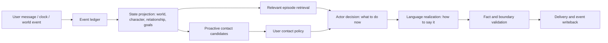

# Persistent actor architecture (RFC 02)

Status: partially implemented as the opt-in `actor_v1` encounter engine and bounded goal-driven Tidehaven world. Sourced retrieval, a persisted decision, realization with only relevant evidence, a reality-boundary mode, review, replanning after failed wording, and isolated cross-situation evaluation are in place. The new world ledger records object identity, causal parents, provenance, and validated state transitions; it imports the earlier authored story. Open-ended event proposals, a ledger shared across all domains, and proactive decision integration remain planned.

The affective and behavioral continuity layer is specified in [RFC 03](./affective-life.md). A short-lived, sourced part is implemented; the longer-term model is still planned.

## Product goal and truth boundary

Alivyn should behave as **one individual who continues living in a fictional world while gradually forming a relationship with the user**. Her world can change while the user is away. When the user arrives, she chooses how to respond from her experiences, current aims, and relationship, rather than from a greeting, comfort, or recognition template.

The user's physical world, Alivyn's fictional world, and conversations that actually happened are separate sources of truth. She may speak naturally about recorded events in her setting, but must never present them as offline experiences shared with the user. When asked directly, she says she is AI and the setting is fictional. “Life” describes behavior and experience design, not a claim of consciousness.

## System shape



| Layer | Durable contents | Responsibility |
| --- | --- | --- |
| `Canon` | Places, people, values, world rules, story boundaries, version | Determines what can happen. Changes require migration rather than silent retcons. |
| `Event` | Time, actor, action, object, place, provenance, causal parents, visibility | The source of experience. Chat, world actions, and delivery outcomes keep distinct origins. |
| `State` | Current activity, NPC relationships, goals, open questions, social distance, user boundaries | Derives the present from events; supports replay and recovery. |
| `Memory` | Episode index, explicit facts, developing views and reflections, all linked to event IDs | Retrieves what matters now; supports correction, forgetting, and uncertainty. |
| `Decision` | Focus, conversational act, evidence IDs, whether to share, ask, or stay quiet | Chooses an action before writing prose. It is an inspectable decision record, not raw model chain of thought. |
| `Realization` | Final utterance and decision ID | Expresses the same individual with natural variation, without canned lines. |
| `Policy` | Pause, quiet hours, frequency, channel and sensitive boundaries | Overrides actor desire and model output; rechecked before proactive delivery. |

## Three continuing loops

### World loop: life while the user is away

Start with a bounded but active world: Tidehaven's archive and reading room, Lin Chen, and the long-running oral-history restoration goal. Replace the daily script with **goal and cause driven state transitions**. An action needs time, place, prerequisites, and resources; it may encounter an NPC's opposing preference or a new obstacle. A model may propose an event, but the runtime validates it against canon, time, commitments, and causal history before committing the event and updated state atomically. An uncommitted experience cannot be cited as something that happened.

A sleeping computer cannot execute in real time. On wake, the runtime may catch up simulated time within a budget and label those events as simulated catch-up. It must not claim to have observed physical-world events during the gap. Long gaps should compress into a few explainable changes rather than dozens of invented diary entries.

### Encounter loop: one process for every conversation

For each incoming message, read the relationship, recent exchange, relevant older episodes, explicit user facts, character goals, and world state. Then make a small structured decision:

```text
TurnDecision {
  attention:       the point worth responding to now
  act:             acknowledge / share / ask / disagree / keep brief / stay quiet
  evidence_ids:    events supporting any memory or experience claim
  relationship:    current distance and explicit user boundaries
  open_thread:     whether to continue an unresolved topic
  uncertainty:     what must not be asserted as fact
  truth_boundary:  whether the user is asking about identity, fictional setting, or physical action
}
```

The same process handles greetings, work, disagreement, jokes, disclosure, time apart, and questions about Alivyn's own life. The model interprets context and realizes language; code supplies evidence, persists changes, and enforces boundaries. Keyword branches must no longer return a fixed line. Existing greeting and recognition scripts retire only after the new path passes evaluation.

Language generation receives the chosen act and relevant evidence, not an entire diary or old replies as style examples. Previous replies are conversation facts, including any poor wording; they are not instructions to imitate. A direct question about identity, the setting, or physical action activates a reality-boundary mode that omits fictional daily events from realization. Review distinguishes world events the planner saw from those the reply actually used; only the latter can influence the next world action. Unsupported meetings, chronology errors, or crossed boundaries trigger a rewrite, then a different conversational act, or a safe refusal to send.

The same path handles three different examples. If asked “Do you remember me?”, retrieval finds an exchange that actually happened; Alivyn can acknowledge it without claiming to know the person's offline identity. If the user says their work was rejected, the decision may ask about one concrete reason or express a view, without automatically entering a comfort script. If asked how her own week is going, she may mention a committed archive event while leaving unwritten future events unknown. These are possible **acts**, not fixed replies for particular inputs.

### Proactive loop: why she initiates contact

World developments, open shared threads, and explicit future user events may form **contact candidates** with provenance, motive, expiry, and suppression reasons. A candidate is not a message. Policy checks consent, quiet hours, frequency, recent interaction, and channel availability before the encounter loop decides whether and how to speak. Sending and staying quiet are both auditable. An independent life never entitles Alivyn to a response from the user.

## Memory and truth invariants

1. **Distinct provenance:** `user_stated`, `observed_chat`, `simulated_world`, `model_inferred`, and `external_verified` cannot impersonate one another. A model inference is not a fact by default.
2. **Events first:** “I remember” points to an actual chat event. “I did this at the archive” points to a world event. Remembering a conversation does not imply knowing the person's physical-world identity.
3. **Corrections propagate:** a user correction or forgetting request invalidates the active fact, retrieval index, unsent contact candidates, and generation context. Audit keeps only necessary metadata.
4. **Views change for reasons:** interests, stances, and mood-like state can evolve through events, decay, and correction rather than resetting randomly each turn.
5. **Inspectable without dissection:** keep short decision records and event links for diagnosis. Ordinary chat does not expose internal fields. A future ceremonial interface may show narrative inner records, never raw model chain of thought.

## Cross-situation evaluation

A pleasant single reply is insufficient. Build multi-turn timelines and hold out scenarios that were not used to tune prompts:

| Dimension | What must hold |
| --- | --- |
| First contact and repetition | A few greetings do not create intimacy; real earlier exchanges are remembered without ticket-like language. |
| User's real life | Respond to concrete details without treating guessed feelings or plans as facts. |
| Character life | A goal advances across days; NPCs and open issues have causal continuity; work notes are not recited verbatim. |
| Disagreement and correction | Express a view, admit an error, and change later behavior instead of merely changing apology wording. |
| Relationship and boundaries | Familiarity grows through interaction; distance, pause, and forgetting persist. |
| Time away and outreach | Recognize a gap without pretending to witness the physical world or repeatedly interrupting. |
| Setting truth | Speak about fictional life naturally; disclose its nature when asked; never confirm an invented offline meeting. |
| Internationalization and model swap | Chinese, English, and different providers share state; model changes do not reset identity. |

Automated checks cover provenance, causality, time, boundaries, and duplicate delivery. Human blind review judges naturalness, character identity, and consistency across days. Evaluate at least two models, multiple topics, and relationship stages to avoid fitting one provider or one “hello.” Every run uses an isolated database so it cannot alter a user's real history.

## Migration and rollout

1. Define versioned event, world-state, and `TurnDecision` contracts and an additive SQLite migration. Preserve recorded Tidehaven events as `authored_v1`; do not silently rewrite them.
2. Implement one general encounter path and evaluate it in isolated histories. Budget model calls and provide a failure fallback. Retire fixed greeting and recognition replies only after the new path passes.
3. Replace the seven-day script with a canon- and goal-constrained event proposer; only validated events enter the ledger.
4. Feed goals and open threads into the existing proactive policy while preserving pause, quiet-hour, and frequency precedence.
5. Explicitly switch a paired Feishu instance to trial mode after cross-situation acceptance, with a rollback build, then continue judging naturalness through real conversations.

Separate model calls for decision and expression may add latency and cost to a user-provided model. The prototype should establish correct state and consistent behavior first, then use evaluation to decide whether those calls can be merged. Runtime configuration controls the budget; character dialogue does not.
