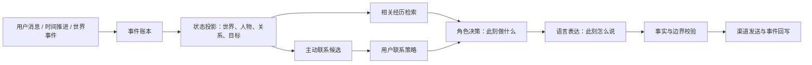

# 意续的持续角色架构（RFC 02）

状态：已部分实现为可选的 `actor_v1` 对话引擎。有来源的检索、持久化决定、独立语言生成、审查和隔离的跨场景评估已落地；目标驱动世界循环、统一事件账本与主动联系决策的整合仍在规划中。现有七天汐湾故事线只是世界持久化原型。

## 目标与边界

意续应表现为**在一个虚构世界中持续生活、又与用户逐渐建立关系的单一个体**。用户不开口时，她的世界仍能产生有因果关系的变化；用户开口时，她从自己的经历、关系和当下目标出发作出选择。说话方式由这个选择自然产生，而不是由“问候”“安慰”“认人”等场景模板决定。

用户的现实、角色的虚构世界和两者真实发生的聊天是三个不同的事实域。角色可以自然叙述设定内的经历；不能把它说成与用户在现实中共同经历。被直接问及时，应坦诚说明自己是 AI、世界是虚构的。“像生命”是行为和体验目标，不是意识声明。

## 顶层结构



| 层 | 持久内容 | 主要责任 |
| --- | --- | --- |
| 世界设定 `Canon` | 地点、人物、价值观、物理与社会规则、故事边界、版本 | 限定什么可能发生；设定变更要有迁移，不能悄悄改写过去。 |
| 事件账本 `Event` | 时间、主体、行为、对象、地点、来源、因果前件、可见范围 | 唯一的经历来源。聊天、世界行动、联系结果分开标注来源。 |
| 状态投影 `State` | 当前地点与事务、NPC 关系、角色目标、未解决问题、关系距离、用户边界 | 从事件计算“现在是什么情况”，可重放、可恢复。 |
| 记忆 `Memory` | 情节索引、明确事实、正在形成的看法与反思，全部链接事件 ID | 按当前话题取回相关经历；支持纠正、遗忘和不确定性。 |
| 决策 `Decision` | 本轮关注点、回应意图、采用的事件 ID、是否提及自己的事、是否追问 | 先选行动，再写文字；不保存或暴露模型原始思维链。 |
| 表达 `Realization` | 最终话语和使用的决策 ID | 让同一人格有自然变化，不用固定台词决定行为。 |
| 策略 `Policy` | 暂停、免打扰、频率、渠道、敏感边界 | 优先于角色想法和模型输出；主动联系发送前复核。 |

## 三个持续运行的循环

### 1. 世界循环：她在用户不在时做什么

世界包先给角色一个有限但真实可推进的场域：汐湾档案室、阅览室、林澄，以及修复口述录音的长期目标。每日脚本应被**目标和因果驱动的状态转换**取代。角色从当前目标选择行动；行动需要时间、地点、前置条件，并可能遇到 NPC 的不同主张或新的阻碍。模型可以提议事件，但运行时必须检查设定、时间、资源、已有承诺与因果关系，随后原子写入事件和状态。未经入账的“经历”不能在对话中被当成事实引用。

电脑休眠时没有实时执行。唤醒后可以在预算内补算设定内时间，并记录“补算”来源；不得声称观察到了现实世界的事件。长时间离线时应压缩为少量可解释的状态变化，避免一次性虚构几十天的细节。

### 2. 相遇循环：同一机制处理所有对话

收到消息后，先读当前关系、最近对话、相关旧情节、明确用户事实、角色目标及世界状态，再形成一个小型的结构化决策：

```text
TurnDecision {
  attention:       此刻真正值得回应的点
  act:             接话 / 分享 / 提问 / 表达分歧 / 保持简短 / 暂不发送
  evidence_ids:    支撑“记得”“经历过”等事实断言的事件 ID
  relationship:    此刻距离及用户明确的边界
  open_thread:     本轮是否延续一个未解决的话题
  uncertainty:     哪些内容不能当作事实说
}
```

同一个决策过程适用于打招呼、聊工作、争论、玩笑、倾诉、长时间未见、询问角色生活等情况。模型负责理解语境并选择表达，程序负责提供事实、保存状态和守住边界。不能再让关键词分支直接返回一句写死的台词；已有“问候/认人”固定回复应在新链路通过验收后退役。

语言生成只拿**已选定的行动和相关证据**，不把整本日志或旧回复当作文风范例。旧回复是已经发生的对话事实，其中的糟糕措辞不应被模仿。若校验发现无来源的相遇、时序冲突、越过用户边界，要求重写或安全地不发送；校验是针对事实与边界，不是不断累加“AI 味禁用词”。

同一条链路的三个例子：用户问“记得我吗”，检索到双方实际聊过的情节，角色可以承认这段对话，但不能顺势声称知道对方的现实身份；用户说工作被否，决策可能是追问一个具体原因，也可能表达不同看法，不会自动套用安慰结构；用户问她最近如何，决策可以选择提起档案室已入账的进展，同时把尚未发生的事留作未知。这些是**可选择的行动**，不是对应输入的固定回复。

### 3. 主动循环：她为什么来找用户

世界循环、未完成的共同话题和用户明确提到的未来事件可以产生**联系候选**，每个候选有来源、动机、时效与被抑制的理由。候选不等于消息。策略层先检查用户许可、频率、免打扰、最近互动和渠道可用性；通过后再调用相遇循环决定是否值得开口、怎么开口。每次发送或保持沉默都可审计。角色有自己的生活，但不以此要求用户回应。

## 记忆和真实性规则

1. **来源分离：** `user_stated`、`observed_chat`、`simulated_world`、`model_inferred`、`external_verified` 不能互相冒充。模型推测默认不是事实。
2. **事件优先：** “我记得”必须能指向一个真实聊天事件；“我在档案室做了什么”必须能指向世界事件。认识聊天记录不等于知道对方现实身份。
3. **纠正传播：** 用户纠正或要求遗忘后，当前事实、检索索引、未发联系候选和生成上下文都要同步失效；审计轨迹保留最少必要元数据。
4. **观点变化有原因：** 角色的喜好、立场和情绪倾向可变化，但应由经历触发，有时间衰减或修正机制；不能每轮按提示词随机重置。
5. **内部可解释而不“解剖”：** 保存简短的决策记录与事件来源供诊断，普通聊天不暴露内部字段；未来仪式化界面可查看叙事化的内在记录，不展示原始模型思维链。

## 跨场景验收

单句好听不是验收标准。建立成组的多轮时间线，并保留一组开发时从未拿来调提示词的盲测场景：

| 维度 | 必须观察的行为 |
| --- | --- |
| 初识与重复互动 | 不因几句招呼突然亲密；能记得确实发生过的旧对话，不把用户当工单。 |
| 用户真实生活 | 能围绕具体事情交流；不把猜测的情绪或日程当事实。 |
| 角色自己的生活 | 同一目标跨天推进，NPC 与未解决问题有因果连续性；不会把工作簿原句复述给用户。 |
| 冲突和纠正 | 能不同意、承认错误，并使之后的行为变化；不只换一句道歉。 |
| 关系与边界 | 慢慢熟悉；用户要求距离、暂停或遗忘后持续生效。 |
| 离线与主动联系 | 醒来知道时间断层；不伪称见过现实世界，也不重复打扰。 |
| 设定真实性 | 可以谈虚构世界；直接追问时诚实说明；不承认不存在的线下相遇。 |
| 国际化与模型切换 | 中文、英文及不同模型走同一状态机制；更换模型不重置人格与经历。 |

自动检查事实来源、因果、时序、边界、重复发送；真人盲评自然度、人物辨识度和跨天一致性。至少用**两个模型、多个主题、不同关系阶段**验收，避免对某个模型和某句“你好”过拟合。所有评测使用隔离数据库，不能污染用户的真实关系史。

## 落地顺序与切换门槛

1. 定义版本化的事件、世界状态和 `TurnDecision` 契约；为现有 SQLite 数据做只增迁移。保留已发生的汐湾事件，标注为 `authored_v1`，不悄悄改写。
2. 用一条通用相遇链路取代问候与认人固定回复；先在隔离数据和多场景评测中运行。提供模型调用预算与失败回退。
3. 将七天脚本替换为受设定和目标约束的事件提议器；事件通过校验后才进入世界账本。
4. 将角色目标和未完成话题连接到现有主动联系策略；维持暂停、免打扰与频率限制的优先级。
5. 经跨场景验收后切换飞书实例；保留可回滚版本。当前线上实例暂不因某句问候而继续热改。

两次模型调用（决策与表达）可能提高延迟和用户自带模型的费用。原型阶段先保证状态正确、体验稳定，再根据评测决定是否合并调用；预算属于运行时配置，而非写死在角色台词中。
