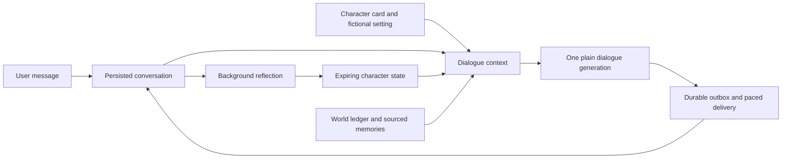

# Character dialogue v2

Status: experimental, opt-in as `character_v2`. [中文](character-dialogue.zh-CN.md).

## Design

The earlier `actor_v1` engine plans an action, realizes it, reviews it and may replan. That is useful for constrained tasks, but in conversation it can discard the original social context, produce commentary about its own behavior and turn ordinary ambiguity into silence. V2 removes that sequence from the reply path.



- **Identity:** a stable character card with preferences, conflicting needs and a personal voice. A custom `persona background` replaces the default card. A cautious character can withhold private information without interrogating the other person.
- **Actual conversation:** up to 40 recent messages retain their user/assistant roles and source order, including when Feishu messages queue. Existing sourced facts and a small selection of older episodes supplement the transcript. This is bounded retrieval, not unlimited memory.
- **Fictional life:** the Tidehaven world ledger retains major events and object continuity. The character can author ordinary activities inside that setting. Those activities are not evidence of real encounters, user facts or device actions.
- **Speech:** one plain-text generation, with no separate action planner, per-message reviewer or greeting/punctuation branches. A short delivery action can accompany speech. Invalid/empty output remains an error for channel retry; the explicit `[[wait]]` choice commits a quiet turn without sending text. No fixed conversational substitute is inserted.
- **Reflection:** a separate worker summarizes the character's own feeling, attention and current scene after delivery. It starts after a 20-second quiet age, normally coalescing updates to every four committed exchanges or ten minutes between source turns. A remaining completed exchange, including a deliberate quiet turn, also qualifies after 90 seconds, so its ending can be recorded without another incoming message. It never edits an utterance or invents user facts. Malformed reflection leaves the earlier snapshot intact and backs off for a minute.
- **Time:** feeling and its cause expire after eight hours; immediate intention, energy and engagement after two; scene after six; attention and unfinished subjects after 72. These are simple expiration rules, not a validated psychological model. The ordinary transcript remains available after a snapshot expires.
- **Delivery:** prepared replies are reused on retry. Reflection ignores Feishu replies awaiting delivery. Forgetting clears derived character state; a reflection already in flight cannot recreate a deleted source. Existing quiet hours, contact limits and reply pacing remain in charge of contact.

The model sees concise authored state, not hidden chain-of-thought. No claim of consciousness is required for the character experience.

## A character with her own choices

The stable card and fictional setting establish who this person is. The current `moment` records feeling, attention, scene and an `intention`: what she has expressed wanting to do next. A separate list of up to three `open_threads` preserves concrete unfinished subjects, with an owner and actual chat-source IDs. A subject can remain unresolved while attention shifts elsewhere.

Both ordinary dialogue and spontaneous-contact judgment use this same state. The character can introduce a subject, continue briefly, return to her own activity, or bring the exchange to a close. Local time supplies context; no production branch says that a particular hour must produce a sleep message. Curiosity or a significant concern may justify changing an earlier intention. Brief replies alone are not treated as evidence of anger, and an old disagreement should not become a permanent interpretation of ordinary questions.

Background reflection updates these small authored snapshots after the exchange. It can retain an unfinished subject, remove one that was resolved or withdrawn, and let an earlier mood soften. It receives the source of the delivered reply too, so the character's own expressed intention need not be attributed to the user. Source IDs are checked for existence; semantic accuracy remains model-dependent. Unfinished subjects are optional context, not obligations or automatic reminders. There is no additional planning model call before each reply, and no claim that these snapshots constitute consciousness.

## Mood, routine and availability

`moment` also records energy, engagement in the current exchange and a brief cause. Reflection considers actual exchanges, supplied fictional-life records and elapsed time. A greeting does not automatically reset a low mood to enthusiasm; low interest in a topic is not a permanent judgment of the user. There is no random mood draw, affection penalty or punishment for not replying. These are model-authored narrative states, not a validated psychological simulation.

The default routine describes resting around 00:30 and rising around 08:00, with room to change plans. Configure it with `alivyn persona routine show` or `alivyn persona routine set '<habits>'`, then restart the running channel.

One generation chooses speech, silence, or a timed absence for sleep, another activity or solitude. `[[wait]]` sends nothing and schedules no follow-up. When timed absence is available, one generation returns a small `mode/reply/absence` envelope. It contains only a delivery choice, actual words and optional absence parameters (kind, RFC3339 return time and short reason), not chain-of-thought or a full emotional report. Only the reply reaches the user. Ordinary completion plus local validation avoids blank output observed with some provider JSON modes; the older `[[away:{...}]]` first-line format is also parsed. The executor validates a return between one minute and sixteen hours away and persists the decision. While away, ordinary messages wait without model polling, and proactive contact is blocked.

At return, waiting messages are reconsidered together, up to eight at a time; no stale bedtime draft is sent. A previously deferred source cannot be deferred again, and another absence is unavailable for an hour after returning. The queue and deadline survive restarts. `/status` shows an active absence; `/wake` ends it early. Wake changes chat routing, not when the character got out of bed. The model receives the local end time and elapsed time of the last absence separately from this control action. Another timed absence remains unavailable for an hour after chat resumes, even if the old deadline had passed or no absence was recorded. Contact restrictions only govern proactive contact. Multi-hour transcript gaps carry time boundaries so old goodbyes are not treated as current intentions.

Unattended deferred delivery currently runs only in the `character_v2` Feishu worker. Terminal chat supports mood, routine, silence and controls, but does not send a background return message. Offline machines cannot deliver; expired work is considered on resumption. The model still chooses whether to leave: this is not a hard nightly schedule or a guarantee of humanlike behavior.

## Controls and diagnostics

Send a command as a separate message. Actions execute locally during ingestion, without a model call. Diagnostic exchanges and ordinary text received while paused or inspecting are excluded from character memory.

| English | 中文 | Effect |
| --- | --- | --- |
| `/help` | `/帮助` | List commands |
| `/status` | `/状态` | Runtime mode, current absence and contact limits |
| `/freeze` | `/暂停` | Pause character replies and proactive contact, keeping memory |
| `/wake` | `/唤醒` | Resume chat and end an absence early, preserving contact restrictions |
| `/quiet` | `/勿扰` | Disable proactive contact |
| `/contact on` | `/允许主动` | Allow initiative, subject to quiet hours and limits |
| `/diagnostics` | `/诊断` | Request internal inspection |
| `/diagnostics confirm` | `/确认诊断` | Confirm within 60 seconds; pause and enter diagnostics |
| `/cancel` | `/取消` | Cancel an unconfirmed request |
| `/persona` | `/人物` | Inspect the character card and fictional setting |
| `/routine` | `/作息` | Inspect daily habits |
| `/memories` | `/记忆` | Inspect up to 20 active extracted facts and source IDs |
| `/state` | `/心境` | Inspect the latest saved state and timestamp |
| `/threads` | `/挂念` | Inspect unfinished subjects and their sources |
| `/resume` | `/返回角色` | Leave diagnostics, restoring the prior running/paused mode |
| `/reset` | `/清除记忆` | Immediately perform the local reset described below |

Internal views require diagnostic entry. They show saved settings and records, not generated self-analysis or hidden chain-of-thought. Snapshots may be stale; extracted facts are not the entire conversation. An expired request cannot enter diagnostics. Modes survive restarts. Pausing or entering diagnostics cancels unsent ordinary replies and proactive contact; a rapid wake cannot revive an old generation. A send already in progress completes before the command. Run one channel process per database.

The inspection ritual takes inspiration from Westworld's analysis mode, suspension and returning to character, using explicit slash commands. See [Ars Technica's episode discussion](https://arstechnica.com/video/watch/all-things-gaming-decrypted-westworld-episode-02-step-into-analysis-mode-please/) and [WIRED's recap](https://www.wired.com/story/westworld-recap-season-2-episode-6/); this does not reproduce the show's claims about consciousness.

## Reset to the initial character

Send **`/reset`** or **`/清除记忆`** as a separate, complete message in Feishu, the TUI or plain terminal chat. The command runs locally and immediately, without calling the model. It is not a request to pretend to forget.

One transaction removes the current conversation, extracted memories, relationship, character state, unfinished subjects, authored world progress, absences, diagnostic records and queued contact/delivery records, returning to running mode. The selected initial persona, name/world configuration, model credentials, channel connection and contact restrictions remain. The fixed acknowledgement is excluded from subsequent model context; the next exchange starts with the initial relationship.

Old Feishu event IDs remain as content-free retry receipts, and database IDs are not reused. Generation results whose source was cleared are discarded; prepared sends are rechecked. Within the channel process, reset is synchronized with the final transport operation: an already-started send finishes before reset, and a cleared queued message cannot be sent afterward. This does not provide a lock across multiple independent processes; run one channel worker per local database.

The reset covers the active local database. Existing Feishu chat messages, provider-side records and separate backups have their own retention. The command does not create a backup of the memories it clears. Operational API consideration counters are retained to prevent repeated resets from increasing background call volume.

## Conversation rhythm

Feishu v2 groups consecutive messages from the same chat after a four-second pause, with a maximum wait of twelve seconds and eight messages per group. The last user message anchors one reply; all inputs remain in the transcript. Group membership is committed before generation, so retries/restarts keep the same contribution. A prepared reply is never absorbed into another group. Messages arriving after a group is claimed form a subsequent contribution. This is bounded coalescing, not a typing indicator or a claim to know when someone has finished.

`internal/character/rhythm.go` supplies participation counts alongside the original dialogue: the size of the current contribution, recent message lengths and recent questions. Small contributions ordinarily receive one short thought; repeated questions or disproportionate speaking discourage further unsolicited elaboration. These are generation cues, not a hard text truncation or a keyword classifier for emotion. Important disclosures and substantive questions can still receive longer answers. No extra model call is introduced.

The character can explicitly leave a completed or uninteresting optional exchange quiet. Direct questions, greetings, corrections and requests for help should still receive attention. The runtime distinguishes intentional silence from a failed generation, persists it and never sends the internal marker. Fictional activities do not authorize promises of photos, attachments or device operations without tools.

## Spontaneous contact

With v2 and the Feishu runtime running, an independent loop considers whether the character has a concrete reason to reach out. It uses the character card, current state, ordered conversation, sourced memories and world events. It can follow up, share or reconnect, or decide to leave things quiet. A proposal contains a brief subject and source IDs; it is not hidden reasoning. Ordinary replies still use one direct generation.

Initial conservative limits:

- The relationship must be beyond stranger and not reserved. A latest conversation older than 72 hours is not a trigger.
- Wait at least 30 minutes after a familiar conversation, or 45 minutes for an acquaintance, plus 0–10 minutes of stable variation. A completed quiet turn also counts as a handled conversation.
- Respect pause, quiet hours, daily contact cap and pending private replies before making an API call. There is at most one consideration per 45 minutes and four per local calendar day; those limits survive restarts.
- A valid proposal cites 1–3 available references and proposes a delay of 5–60 minutes. It expires after three hours. An identical kind/source set is suppressed for 72 hours.
- Recheck the conversation after judgment, before composition and before sending. New user messages cancel pending spontaneous proposals. Composition can also choose silence.
- After an unanswered proactive delivery, spontaneous contact waits for the user to return. No escalating complaints or guilt messages.

Existing interview, wake and world-update intents retain their own triggers and share the contact policy. The new limits above apply to spontaneous consideration. `serve` remains a local outbox demo; spontaneous model consideration runs in the Feishu channel worker. Sleeping/offline machines cannot generate or deliver until their runtime returns.

```sh
alivyn contact status
alivyn contact pause
alivyn contact resume
alivyn contact simulate
```

`contact simulate` uses synthetic conversations and a virtual clock in disposable databases, with the configured model/key. It makes paid model calls but sends no channel messages and leaves the installed history unchanged. It reports sharing, respecting concentration and leaving a closed subject alone. A model can choose silence even for the sharing example; the command is an inspection tool, not a deterministic quality benchmark.

### Reference mechanisms

The independently written implementation draws on the separation of background scheduling, timing judgment, speech generation, cooldown and reply coordination in [astrbot_plugin_group_chat_plus](https://github.com/Him666233/astrbot_plugin_group_chat_plus), particularly [proactive_chat_manager.py](https://github.com/Him666233/astrbot_plugin_group_chat_plus/blob/main/utils/proactive_chat_manager.py) (reviewed blob `a18e22281bac419a04c131e9ff2ba04cae5c6647`). Its README describes a group-chat plugin with unfinished private-chat support. No upstream source or persona prompt is copied. Video screenshots alone do not establish the model, private persona or plugins used in that particular demonstration.

The similarly named [dsh-dafeiyu](https://github.com/QCYTSN/dsh-dafeiyu) describes a desktop pet that displays DeepSeek Harness task states; it does not itself call a model. It is not evidence of the emotional dialogue mechanism in those screenshots.

## Try and compare

```sh
alivyn actor set character_v2
# Restart an existing channel process; terminal chat reads config on startup.
alivyn chat

ALIVYN_AUDITION_REPORT=/tmp/character.json alivyn actor audition character_v2 all
ALIVYN_AUDITION_REPORT=/tmp/actor.json alivyn actor audition actor_v1 all
```

Auditions use isolated databases and the configured provider/key. They do not send Feishu messages or modify the installed character. They make paid API calls. Each report preserves errors, replies, generation latency, generation call count and separate reflection results. Optional environment variables `ALIVYN_AUDITION_MODEL`, `ALIVYN_AUDITION_THINKING` and `ALIVYN_AUDITION_EFFORT` support provider comparisons; these do not change live configuration. The fixed scenarios cover introductions, frustration, teasing, everyday continuity, hesitation, memory correction, reality/capability boundaries, pacing, changes in interest, independent plans, unfinished subjects and reset. The `leaving an active chat` case starts from an explicitly seeded prior intention; it checks continuity, not whether every late conversation ends identically. The `low mood continuity` case checks a seeded mood; `sleep and return` uses an isolated durable inbox and virtual clock, recording actual speech/absence choices and queued inputs without forcing sleep. They are inspectable examples, not a quantitative proof of humanlike behavior.

`alivyn actor set actor_v1` restores the previous experiment after restart; `legacy` restores the original engine. New installations still default to `legacy` during evaluation.

## Current limits

Some models still miss implied jokes, ask excessive questions, or invent a physical alibi when a user claims an offline meeting. Prompt boundaries are not a factual verifier. A single attractive reply does not establish quality across situations. The initial comparison also found blank JSON outputs when speech and state were combined; that is why reflection is off the delivery path.

Long-term evolving beliefs, open-ended autonomous life simulation and phone operation are not implemented by this engine. Current world progression remains bounded. Future changes should be evaluated on longer unseen conversations, callbacks across restarts and changes in emotional intensity, rather than adding special-case greetings.

## Implementation

`internal/character/` owns the bilingual prompts, default card, ordinary generation and reflection. `internal/session/character.go` assembles source-bound context and owns the reflection worker. `internal/store/character.go` persists drafts, committed turns, expiring state and world-event receipts. Provider-specific options live in `internal/model/`; compatible custom endpoints do not receive DeepSeek thinking parameters by default.
