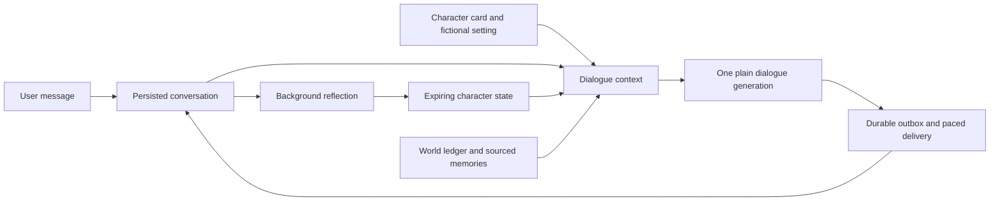

# Character dialogue v2

Status: experimental, opt-in as `character_v2`. [中文](character-dialogue.zh-CN.md).

## Design

The earlier `actor_v1` engine plans an action, realizes it, reviews it and may replan. That is useful for constrained tasks, but in conversation it can discard the original social context, produce commentary about its own behavior and turn ordinary ambiguity into silence. V2 removes that sequence from the reply path.



- **Identity:** a stable character card with preferences, conflicting needs and a personal voice. A custom `persona background` replaces the default card. A cautious character can withhold private information without interrogating the other person.
- **Actual conversation:** up to 40 recent messages retain their user/assistant roles and source order, including when Feishu messages queue. Existing sourced facts and a small selection of older episodes supplement the transcript. This is bounded retrieval, not unlimited memory.
- **Fictional life:** the Tidehaven world ledger retains major events and object continuity. The character can author ordinary activities inside that setting. Those activities are not evidence of real encounters, user facts or device actions.
- **Speech:** one plain-text generation, with no action-label planner, per-message reviewer, JSON state contract or greeting/punctuation branches. Invalid/empty output remains an error for channel retry; no fixed conversational substitute is inserted.
- **Reflection:** a separate worker summarizes the character's own feeling, attention and current scene after delivery. It starts after a 20-second quiet age, then coalesces updates to every four committed exchanges or ten minutes between source turns. It never edits an utterance or invents user facts. Malformed reflection leaves the earlier snapshot intact and backs off for a minute.
- **Time:** feeling expires after two hours, scene after six, attention after 72. These are simple expiration rules, not a validated psychological model. The ordinary transcript remains available after a snapshot expires.
- **Delivery:** prepared replies are reused on retry. Reflection ignores Feishu replies awaiting delivery. Forgetting clears derived character state; a reflection already in flight cannot recreate a deleted source. Existing quiet hours, contact limits and reply pacing remain in charge of contact.

The model sees concise authored state, not hidden chain-of-thought. No claim of consciousness is required for the character experience.

## Try and compare

```sh
alivyn actor set character_v2
# Restart an existing channel process; terminal chat reads config on startup.
alivyn chat

ALIVYN_AUDITION_REPORT=/tmp/character.json alivyn actor audition character_v2 all
ALIVYN_AUDITION_REPORT=/tmp/actor.json alivyn actor audition actor_v1 all
```

Auditions use isolated databases and the configured provider/key. They do not send Feishu messages or modify the installed character. They make paid API calls. Each report preserves errors, replies, generation latency, generation call count and separate reflection results. Optional environment variables `ALIVYN_AUDITION_MODEL`, `ALIVYN_AUDITION_THINKING` and `ALIVYN_AUDITION_EFFORT` support provider comparisons; these do not change live configuration. The seven fixed scenarios cover introductions, frustration, teasing, everyday continuity, hesitation, memory correction and reality/capability boundaries. They are inspectable examples, not a quantitative proof of humanlike behavior.

`alivyn actor set actor_v1` restores the previous experiment after restart; `legacy` restores the original engine. New installations still default to `legacy` during evaluation.

## Current limits

Some models still miss implied jokes, ask excessive questions, or invent a physical alibi when a user claims an offline meeting. Prompt boundaries are not a factual verifier. A single attractive reply does not establish quality across situations. The initial comparison also found blank JSON outputs when speech and state were combined; that is why reflection is off the delivery path.

Long-term evolving beliefs, open-ended autonomous life simulation and phone operation are not implemented by this engine. Current world progression remains bounded. Future changes should be evaluated on longer unseen conversations, callbacks across restarts and changes in emotional intensity, rather than adding special-case greetings.

## Implementation

`internal/character/` owns the bilingual prompts, default card, ordinary generation and reflection. `internal/session/character.go` assembles source-bound context and owns the reflection worker. `internal/store/character.go` persists drafts, committed turns, expiring state and world-event receipts. Provider-specific options live in `internal/model/`; compatible custom endpoints do not receive DeepSeek thinking parameters by default.
