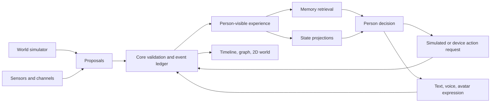

# World and Person Runtime (RFC 04)

Status: **architecture target with one runnable world–person event path, not a completed plugin host**. The experimental `pkg/extension` `v1alpha1` contract supports explicit registration and selection. `character_v2` can use selected memory retrieval and current-state projection modules, and the daily reading loop can use a selected perception module. Chat, recording-world progress, readings, contact decisions, and new simulated scenes enter one source-reference event index. The built-in Tidehaven simulator asks the user-configured model for one bounded daily scene; only a witnessed scene reaches the character's dialogue evidence. `alivyn inspect demo|timeline|person|graph` is the terminal acceptance path. Existing SQLite and public RSS implementations remain the defaults; ADB, vision, audio, physical devices, the 2D world, and the graphical console are future modules.

The `character.initiative` `decide` slot now also accepts a selected social-decision module. It may propose sourced impulses and a contact or wait choice; the core validates evidence and still owns relationship boundaries, quiet hours, cadence, persistence, and delivery. The built-in character decision remains the default. This is an explicitly registered in-process interface, not an installation host for arbitrary external code.

## Model

Alivyn is a person who experiences events in bounded worlds, forms a subjective view, and chooses actions. A world and a person are separate objects.

| Owner | Responsibility |
| --- | --- |
| Kernel | Stable IDs, event commits, clocks, permissions, module selection, delivery and device receipts, forgetting, audit. |
| World | Places, entities, rules, resources, schedules, and fictional event proposals. It cannot write a person's memories directly. |
| Person | Biography, memory, attention, relationships, needs, interests, affect, goals, commitments, decisions, and expression. It cannot rewrite world facts. |
| Environment | Real channels, phones, cameras, microphones, and physical devices. Their observations remain distinct from fictional events. |
| Observer | Timeline, memory graph, diagnostics, and 2D world view. These consume core events and projections rather than keeping another source of truth. |

**An event is what happened; an experience is what this person could perceive; a memory is what they can later recall.** A simulator may record an event in another room. The person cannot remember it until they witness it or hear about it. A model interpretation is revisable and does not become a world fact.

## World and person

A world package defines `world_id`, version, clock, places, entities and NPCs, affordances, resources, constraints, initial state, and event schemas. A person has a stable `actor_id`. They may enter different worlds, but events retain their world and reality domain. The simulator **proposes** transitions; the core verifies place, participants, prerequisites, elapsed time, resources, and causal parents before committing them. Events identify who was present and who learned about them later. After a machine wakes, a bounded catch-up may be simulated and labelled; it is never presented as real-time observation during sleep.

For example, the simulator commits an event at 15:00: a colleague discovers that a recording date is wrong in another room. The console can show it, but Alivyn does not suddenly know it. At 17:00 the colleague tells her; that reported experience can enter recall and affect her plan. The 2D view shows world events and positions, while chat uses only what she could know.

The person is composed from replaceable projections: self and biography; episodic and factual memory; relationships; affect and energy; interests and needs; goals and commitments; attention; and social decisions. These are capability slots, not a requirement to publish one plugin for every field. A single module may provide several projections. Each result needs a schema version and source event IDs. Corrections and forgetting must invalidate affected projections and recall indexes.

## Module contracts

The current API defines `perceive`, `simulate`, `project`, `recall`, `decide`, `act`, and `express`. A manifest declares capabilities and requested permissions. Registration does not activate a module; activation does not grant a device permission. Slots select implementations explicitly, such as `character.memory`, `character.affect`, `world.tidehaven`, or `phone.default`.

Examples: a vision or audio module proposes sourced observations; a world simulator proposes fictional events; a memory module retrieves relevant experience; an affect/relationship/interest module projects state; a decision module chooses whether and how to act; an expression module turns one decision into text, voice, or avatar behavior. A console or 2D client reads events by sequence and named projections. Graph edges must link to events and label witnessed, reported, and inferred relationships; animation cannot invent an event that the runtime did not commit.

Real-device control follows `ActionRequest → scoped authorization → idempotent execution → ActionReceipt → event commit`. A model may request an action but cannot call ADB, a robotic hand, or a message sender directly. Screen reading, sending messages, installing apps, payments, and physical movement require distinct permissions. A timeout is not success. Initial phone work should start with read-only screenshots and status; action grants come after the gateway and receipts exist.

## Event data and hosting

Events need a stable ID, monotonic sequence, occurrence and recording times, domain, world ID, subject, observers, provenance, visibility, causal parents, schema version, and payload. Domains include `conversation`, `simulated_world`, `observed_real`, `device_effect`, and `inference`. Inference cannot silently become fact. The core owns forgetting and tells indexes and projections to invalidate their caches; plugins do not independently decide what to erase.

Built-in modules can initially register Go interfaces. Installable third-party modules should later use an isolated process and versioned JSON messages instead of Go's platform-dependent dynamic `plugin` loader. The host must scope event reads and file, network, and device access, and handle timeouts, health checks, migration, and failure fallback. Model vendors remain user-configurable.

## Migration path

1. **Done:** experimental contract and explicit registry; character memory, affect, and public-reading perception have selected-module seams with SQLite and RSS defaults. A source-reference event index covers old chat, recording-world progress, readings, contact decisions, and validated simulated scenes without copying private chat text. Reset clears the index. A model-backed Tidehaven module may propose one scene per day in the Feishu runtime. A terminal timeline, person view, Mermaid graph, and isolated world–person demo are available.
2. Complete the event index for delivery receipts and reflection. Existing source tables still own their records. Continue verifying restart, correction, forgetting, and replay.
3. Project relationship, interests, goals, attention, and affect from the same person-visible events; ordinary and proactive decisions consume the same state.
4. Wrap the existing recording task as the first world module, then admit validated simulator proposals. Build the console and 2D view as read-only event consumers first.
5. Add read-only phone perception, images, and voice. Add ADB actions only after authorization, idempotency, and receipts work; physical devices follow the same boundary.

Acceptance requires consistent time, location, memory, and relationship across chat, unattended world progress, console, and 2D view. Swapping a projection must not rewrite events. A failed device action cannot be narrated as completed. Forgetting must clear derived views and pending outreach.
