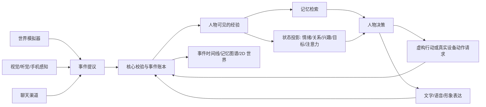

# 世界与人物运行时（RFC 04）

状态：**架构目标与可验收的第一条世界—人物事件链已落地，完整插件宿主尚未落地**。`pkg/extension` 提供实验性 `v1alpha1` 契约、显式注册和选择；`character_v2` 的人物记忆读取、当下状态读取，以及日常阅读的感知来源，已能通过选中的模块运行，默认仍使用现有 SQLite 与公开 RSS 实现。聊天、录音世界事件、阅读、联系决定与新模拟场景进入同一条来源索引；内置汐湾模拟器每天向用户配置的模型请求一个有边界的小场景，只有人物在场的事件进入她的对话证据。`alivyn inspect demo|timeline|person|graph` 提供终端验收入口。ADB、视觉、语音、机器人执行器、2D 世界和图形控制台仍是扩展目标。

## 基本模型

主动联系决策现在也接入 `character.initiative` 的 `decide` 槽位。第三方模块可提交带来源的念头与“联系/等待”提议；核心验证来源、记录决定，并独立执行勿扰、关系边界、节奏和发送复核。未选择模块时仍使用内置人物决策。当前是进程内显式注册接口，不是可直接安装任意外部代码的插件宿主。

人物还有独立的**内在唤醒**循环：它先读取亲历事件与当前状态，再保存一份有来源的关注点、缘由和最多三个社交念头；这一层不发送消息，勿扰和联系暂停也不停止它。随后，联系决策才判断是否想说、能否说，以及具体说什么。人物关注自己的生活时仍可能惦记用户；如果模型暂时无法形成内在状态，联系决策会回退到原有路径。完成的内在唤醒进入统一事件索引，可在诊断模式用 `/内心` 查看简要状态。重置和遗忘会清理派生状态；完整可替换的内在唤醒插件尚未实现。

意续的核心不是聊天窗口，而是**一个人物在一个或多个有边界的世界中经历事件、形成主观经验、作出选择**。世界和人物必须分开建模：

| 对象 | 拥有什么 | 不拥有的权力 |
| --- | --- | --- |
| 核心 `Kernel` | 身份 ID、事件提交、时钟、权限、模块选择、发送与设备动作回执、遗忘和审计 | 不替人物写死感受或台词 |
| 世界 `World` | 地点、实体、规则、资源、日程、事件提议、可执行的虚构动作 | 不直接写入人物记忆，不宣称现实设备动作已经发生 |
| 人物 `Person` | 自我叙事、记忆、注意力、关系、需要和兴趣、情绪、目标、承诺、行动与表达选择 | 不直接篡改世界事实或绕过用户边界 |
| 外部环境 `Environment` | 飞书、手机、摄像头、麦克风、实体设备等真实输入输出 | 不自动变成虚构世界设定，也不获得其他设备的权限 |
| 观察界面 `Observer` | 控制台、记忆图谱、事件时间线、2D 世界视图 | 不维护第二份人物真相；修改需提交显式命令 |

**事件是发生过的事，经验是人物实际感知到的事，记忆是人物后来能取回的事。** 三者不能合并。模拟器可以记录隔壁房间发生了什么；意续没有看见、听见或被告知，就不能把它写成自己的回忆。模型的解释是可修正的主观看法，不是世界事实。

## 世界层

一个世界包至少定义 `world_id`、版本、时钟规则、地点和连通关系、实体/NPC、可用动作、资源与约束、初始状态、事件 schema。人物有稳定 `actor_id`；同一个人物可以进入多个世界，但事件必须保留原世界 ID，不能混成现实经历。

模拟器的职责是按当前世界状态和时间**提出**事件：例如“她在阅览室整理一段录音，发现日期冲突”。核心检查前置条件、参与者、地点、经过时间、既有事件和资源，再提交事件；失败的提议不会变成回忆。角色自己选择的虚构动作也走同一流程。NPC 事件可独立发生，但需标明谁实际在场、谁后来得知。

世界时钟与真实时钟分开。电脑休眠时世界不伪称实时运行；恢复后可以按预算补算少量事件并标记来源。模拟器版本升级必须提供状态迁移或从事件重放，不静默重写过去。

例如：15:00，模拟器提交“林澄在另一间屋子发现录音日期有误”。控制台时间线可以显示这件事，但意续当时不在场，聊天中也不会突然知道。17:00，林澄把发现告诉她；这条“被告知”的经验才进入她可检索的记忆，可能改变她当晚的计划与心情。2D 画面显示的是世界事件与人物位置，聊天说法来自她实际知道的那部分。

## 人物层

人物不是一个总分。她的状态由几类可替换的投影共同构成：

| 投影 | 输入与输出 | 对行为的影响 |
| --- | --- | --- |
| 自我与传记 | 已确认的人物事实、过去的选择及其变化 | 保持身份连续；允许有证据地改变看法 |
| 情景记忆与事实记忆 | 可见事件、用户明确陈述、纠正、遗忘 | 按话题召回；区分“听说”“猜测”“亲历” |
| 关系 | 共同经历、明确边界、冲突和修复 | 决定熟悉程度、信任与联系意愿；不按消息条数机械加好感 |
| 情绪与精力 | 近期事件、长期倾向、休息与压力 | 影响注意和语气；有原因、有时间跨度，可恢复 |
| 兴趣与需要 | 自己的活动、反复选择、未满足的事 | 产生不依赖用户提问的行动和话题 |
| 目标与承诺 | 人物目标、对用户说过的话、未完成任务 | 驱动跨天行动，兑现或解释变化 |
| 注意力 | 当前场景、被打断的事、重要未了话题 | 决定此刻注意什么，允许犹豫、暂缓或不回复 |
| 社交决策 | 上述投影、当前消息、可用能力和政策 | 决定回答、分享、追问、结束、沉默或主动联系 |

这些是**能力槽位**，不要求每项拆成一个插件。一个实现可以同时提供关系与情绪投影；也可以替换单个记忆检索器。核心只要求输出有版本、有来源，且能在撤销或遗忘事件后重算。模块不能把猜测直接写入已确认事实，也不能向人物提供她没有感知到的世界事件。

## 扩展能力与运行契约

`pkg/extension` 当前定义七类接口：`perceive` 感知、`simulate` 世界模拟、`project` 状态投影、`recall` 记忆检索、`decide` 决策、`act` 行动、`express` 表达。一个模块声明它实现的能力和所需权限；注册不等于启用，启用不等于获得设备权限。核心以槽位显式选择实现，例如 `character.memory`、`character.affect`，未来还有 `world.tidehaven`、`phone.default`、`voice.outbound`。

| 扩展例子 | 接入方式 | 必须回写 |
| --- | --- | --- |
| 图片/听觉 | 感知模块返回带来源、时间和媒体引用的观察；理解结果需标注模型推断 | 观察事件和解释来源 |
| ADB 手机 | 手机模块提供截图/通知观察，以及按操作名限定的点击、滑动、输入等动作 | 设备动作请求、授权、执行回执、失败结果 |
| 灵巧手/实体机器人 | 设备模块报告能力、状态和传感器输入；动作受空间、力度、急停等设备约束 | 实际执行结果和传感器确认 |
| 虚拟世界模拟器 | 提出有地点、参与者、时间和因果前件的虚构事件 | 已校验的世界事件与人物是否在场 |
| 记忆/关系/情绪模块 | 只读事件和可见经验，输出带来源的检索结果或状态投影 | 投影版本与采用的事件 ID |
| 文字/语音/2D 形象 | 根据同一次人物决策产生不同表达 | 发出、失败及用户可见的内容 |
| 控制台/记忆图谱/2D 世界 | 按事件序号读取时间线及命名投影，支持回放；交互写入用户命令 | 命令本身及其结果 |

真实设备动作必须走 `ActionRequest → 权限/范围检查 → 幂等执行 → ActionReceipt → 事件提交`。模型只能提出请求；不能直接调用 ADB、机械臂或发送接口。读取屏幕、发送消息、安装应用、支付、移动实体设备是不同权限。执行器超时不能被当成成功；重试必须能查询同一请求 ID 的结果。首个手机模块应先做只读截图和状态，随后才开放经明确授权的动作。

图谱控制台和 2D 客户端通过带游标的事件读取与命名投影建立画面。图谱边应指向真实事件及其参与者，标出“她亲历”“别人告知”“她的推测”；2D 画面读取世界地点、动作和时间，不通过动画反向编造事件。查看人物私密叙事需要显式的诊断入口；普通聊天不暴露模型原始思维链。

## 数据与模块宿主

事件至少有：稳定 ID、递增序号、发生时间、记录时间、事实域、世界 ID、主体、在场者、来源、可见范围、父事件、schema 版本和载荷。事实域要区分 `conversation`、`simulated_world`、`observed_real`、`device_effect`、`inference`。`inference` 永远不能在重放时自动升格为事实。遗忘不是让插件各删各的：核心撤销或遮蔽指定范围，并通知索引与投影失效；插件缓存必须带事件水位和版本。

第一阶段内置模块可用 Go 接口注册。第三方安装式插件不依赖 Go 的 `plugin` 动态库；后续采用独立进程和版本化 JSON 消息协议，由宿主隔离文件、网络和设备权限，并提供超时、故障降级、健康检查与升级迁移。不同模块可使用不同模型，但模型提供商仍由用户配置。世界模拟器和人物模块都不能直接持有聊天渠道或数据库写权限。

## 从当前代码迁移

1. **当前已完成：** 实验性能力契约与显式注册；`character_v2` 的记忆读取、人物当下状态和公开阅读来源可换模块，未选择时继续使用现有 SQLite 与 RSS 实现。新增基于来源引用的事件索引和场景模拟器入口，不复制用户聊天正文；旧聊天、目标世界、阅读、内在唤醒和联系决定可回填，重置会清除索引。内置汐湾模块可每天通过所选模型提出一个场景，飞书后台会运行它；独立的内在唤醒可继续她的自身生活线索。终端可查看时间线、人物可见事件和 Mermaid 图。
2. **下一阶段：补齐事件账本。** 发送结果和人物反思仍需纳入统一索引；现有表仍是各自数据的权威来源。继续检验重启、纠正、遗忘与回放的一致性。
3. **人物循环。** 把关系、兴趣、目标、注意力和情绪从分散提示内容迁移为带来源的投影，让主动联系和普通回复读同一份人物状态；保留可替换实现。
4. **世界循环。** 将当前固定录音任务包装为第一种世界模块，再加入能提议事件且通过因果校验的模拟器。2D 客户端和控制台先读事件和投影，不影响人物行为。
5. **外部能力。** 从只读手机感知、图片和语音开始；完成权限、回执与幂等网关后接 ADB 动作，之后再考虑实体设备。

验收不能只看插件能否加载。要验证同一人物在聊天、无人时世界推进、控制台和 2D 画面中的位置、关系、记忆和时间一致；换掉记忆或情绪模块不改变已发生的事件；设备动作失败不能被叙述为成功；忘记一段经历后所有投影与未发送联系都失效。
